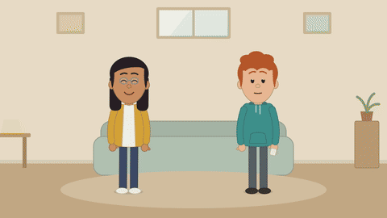
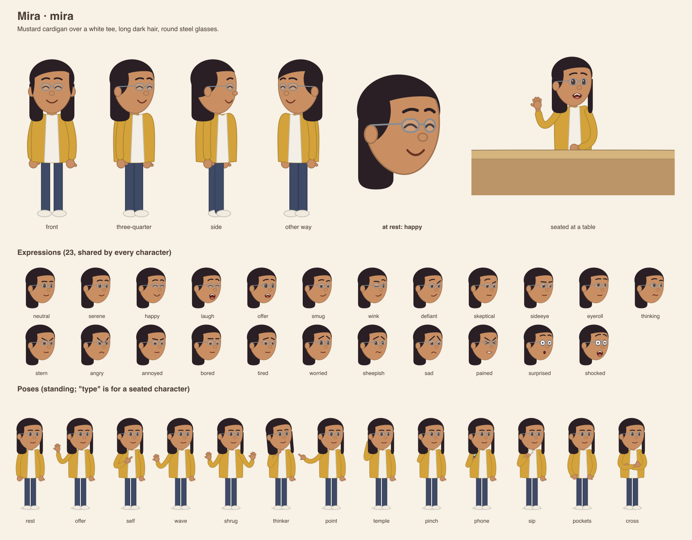
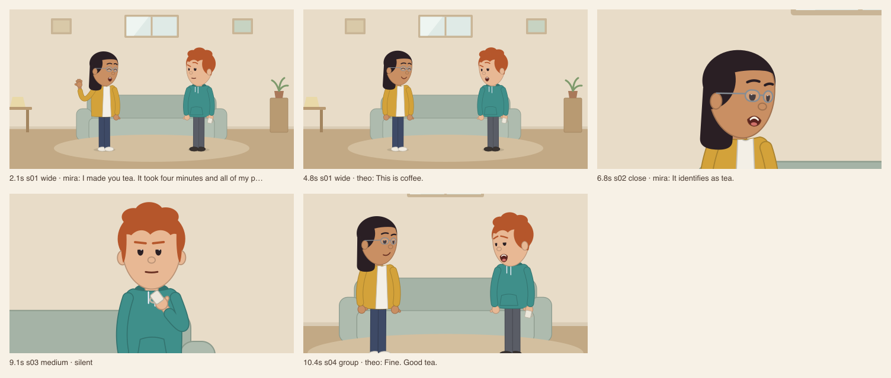
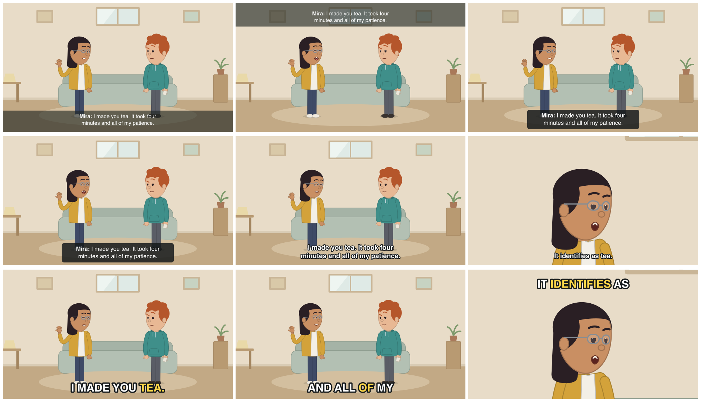

# 2d-character-sketch

An agent skill that makes simple 2D cartoon characters and short talking sketch videos. Everything is drawn by code on your own machine, so a render costs nothing and the same input always gives the same video.



Ask your coding agent for any of these and it follows the skill:

- "Build me a character: a tired barista with a green apron." You get a character sheet.
- "Make her say: we are out of oat milk." You get a short lip-synced clip.
- "Add a customer and make a four-shot sketch in the park." You get a 1920 × 1080 video.
- "I have an idea: a barista who refuses to admit the oat milk ran out. Thirty seconds." You get a script to comment on before anything is drawn.
- "Here is my script. Direct it." Your words are kept, and the set, tone, pace, shots and pauses are filled in.
- "Put captions on it, the big word-by-word kind." You get the same video with the words on screen, and a subtitle file beside it.
- "Show me some ready-made characters." You get a line-up of twelve starters to pick from and change.
- "Four people on a Zoom stand-up." You get square video-call tiles, with everyone facing their own camera.

The preview above was rendered from [examples/sketches/tea.json](examples/sketches/tea.json). It is a silent GIF; the rendered video has speech.

## What a character is

A character is one small JSON file of colours and choices: 22 hair styles, beards, a moustache, a beanie or a cap, glasses, height, and the colours of skin, hair and clothes. Eyes, mouths, hands, 24 expressions, the poses, 24 stock gestures and 31 stock reactions are shared by every character, so a new one can act straight away. Twelve ready-made starters ship with the skill (`node scripts/sketch.mjs starters`), designed so no two share a hair shape or a top colour.

```json
{
  "id": "mira",
  "name": "Mira",
  "skin": "#c98f63",
  "hair": "#2a1f24",
  "style": "long",
  "glasses": "steel",
  "top": "#d3a23a",
  "front": "open",
  "resting": "happy"
}
```



## What a sketch is

A sketch is one JSON file: a room, a cast, and a list of shots. Each shot has a framing and its lines. You never write timestamps; the tool times everything from the recordings.

```json
{
  "set": "home",
  "cast": ["mira", "theo"],
  "shots": [
    { "frame": "wide", "lines": [
      { "who": "mira", "say": "I made you tea.", "face": "happy", "pose": "offer" },
      { "who": "theo", "say": "This is coffee.", "face": "skeptical" }
    ] },
    { "frame": "close", "on": "mira", "lines": [
      { "who": "mira", "say": "It identifies as tea.", "face": "smug" }
    ] }
  ]
}
```

Every render also writes a contact sheet, one picture per line, which the agent checks before showing you the video.

A sketch can also:

- move between rooms as **scenes** in one file, with **title cards** such as "Three days later";
- use any of **twelve rooms**: `plain`, `home`, `park`, `office`, `table`, `conference`, `terrace`, `kitchen`, `reception`, `cafe`, `corridor` and `call`, or an SVG backdrop of your own;
- seat people on a sofa or a bench, walk them into and out of frame, and have two of them **high-five, shake hands, bump fists or hand something over**;
- put one of **21 things** in someone's hand, from a mug or a microphone to a trophy;
- play a **stock gesture** on a chosen word (air quotes, counting on fingers, a facepalm) or a **stock reaction** that ends by itself (a single wink, an eye-roll, a slow double take);
- mix in **sound effects and music** from files, including twelve plain free sounds the tool makes (`sounds`).



## Preparing the script

Give the agent an idea and it writes a short script, shows it to you in plain reading form, and asks one pointed question at a time until you are happy. Give it a finished script and it keeps your words and fills in the rest: who stands where, the room, the tone, the pace, the framings and the pauses. The instructions it follows are in [references/script.md](references/script.md).

Any sketch file can be printed as a readable script with its estimated length:

```sh
node scripts/sketch.mjs script sketches/tea.json --dir examples
```

```
Tea
set: home · cast: mira, theo · pace: normal · captions: bar (auto)
about 14.8 s · 4 shot(s) · 4 line(s) · 23 words

1. WIDE   0.0–8.0 s
     MIRA (happy, offer): I made you tea. It took four minutes and all of my patience.
     THEO (skeptical): This is coffee.
2. CLOSE on mira   8.0–10.7 s
     MIRA (smug): It identifies as tea.   [Theo: bored]
```

## Captions

Four styles are built in. Set `"captions": "pop"` at the top of a sketch, or add `--captions pop` to a render.

| Style | Look |
| --- | --- |
| `bar` | A dark band across the screen, with the speaker's name |
| `box` | A rounded dark box that hugs the words, with the name |
| `outline` | Bold white words with a dark edge, no background |
| `pop` | A few big words at a time, the word being said in yellow |



Captions can sit at the bottom or the top, with or without names, as two rows or a few words at a time. Without a setting, only lines that have no recording are captioned. When captions change word by word, the timing is estimated from the letters in the line, not measured from the sound.

**Subtitle file.** Every render also writes `captions.srt` beside the video: the same captions, split and timed the same way, for a site that shows its own captions, such as YouTube. It is written even with `--captions off`, so the picture can stay clean.

## Install

You need Node 20 or newer, FFmpeg and `rsvg-convert` (from librsvg). There are no npm packages.

```sh
# Mac
brew install ffmpeg librsvg
# Debian or Ubuntu
sudo apt install ffmpeg librsvg2-bin
```

Then clone this repository into your agent's skills folder.

```sh
# Claude Code, for every project
git clone https://github.com/yenceesanjeev/2d-character-sketch ~/.claude/skills/2d-character-sketch

# or for one project (Claude Code)
git clone https://github.com/yenceesanjeev/2d-character-sketch .claude/skills/2d-character-sketch

# or for agents that read .agents/skills (for example Codex)
git clone https://github.com/yenceesanjeev/2d-character-sketch .agents/skills/2d-character-sketch
```

For mouths that match the spoken sounds, install [Rhubarb Lip Sync](https://github.com/DanielSWolf/rhubarb-lip-sync) (MIT licence). It is a separate program, so it is not part of this repository. This script downloads the official 1.14.0 release for macOS or Linux (87 MB), checks it, and keeps about 90 MB in `~/.2d-character-sketch/rhubarb`, where the tool finds it with no setting:

```sh
bash ~/.claude/skills/2d-character-sketch/scripts/install-rhubarb.sh
```

On an Apple-silicon Mac it runs through Rosetta (`softwareupdate --install-rosetta` if you have not installed it). On Windows, download the release yourself and set `RHUBARB` to `rhubarb.exe`.

Check the setup:

```sh
node ~/.claude/skills/2d-character-sketch/scripts/sketch.mjs doctor
```

## Use it without an agent

The skill is a set of instructions plus one command-line tool, and the tool works on its own. From this repository:

```sh
node scripts/sketch.mjs sheet --dir examples                    # draw every character sheet
node scripts/sketch.mjs say theo "This is coffee." --dir examples
node scripts/sketch.mjs render sketches/tea.json --dir examples  # the sketch above
```

Add `--draft` for a fast half-size render. The file formats are documented in [references/character.md](references/character.md) and [references/sketch.md](references/sketch.md).

## Voice

The default is free. Tell your agent which voice to use ("use OpenVoice", "use ElevenLabs", "use Sarvam") and it switches.

**For a sketch that should sound realistic, use ElevenLabs.** The free voices read flatly, and delivery is most of what makes a line land. A good order of work is to settle the lines and timing with a free voice, then generate the ElevenLabs voice once.

| Engine | Cost | Notes |
| --- | --- | --- |
| macOS `say` | Free | The default on a Mac. Robotic, but good for timing. |
| OpenVoice | Free, local | Optional install of about 2 GB (`bash scripts/install-openvoice.sh`, needs [uv](https://docs.astral.sh/uv/)). Five English voices from MeloTTS, the speech model of OpenVoice V2. `"openvoiceSpeed"` in a sketch (0.8 to 1.3) makes it a little faster or slower. |
| ElevenLabs | Paid | The most realistic. Needs your API key and a voice id per character. |
| Sarvam | Paid | Needs your API key and a speaker per character. Indian English and ten Indian languages. |
| None | Free | Lines play silent with captions. |
| Your own recordings | Free | Name an audio file on any line. |

For a paid voice, put your key in a file named `.env.local` in your working folder (and list that file in `.gitignore`), or in `~/.2d-character-sketch/keys.env` to cover every project:

```
ELEVENLABS_API_KEY=your-key
SARVAM_API_KEY=your-key
```

The tool never prints a key, refuses a key file that git is not ignoring, and sends nothing to a paid service until you pass a cap on the characters of text it may send (`--max-chars`). Recordings are kept, so an unchanged line is never charged twice. `node scripts/sketch.mjs credits` shows how many ElevenLabs credits you have left, and the readable script shows what a sketch would cost before anything is sent. After a paid render the tool lists any recording that runs suspiciously long for its words, so you know which lines to play.

Mouth shapes match the spoken sounds when Rhubarb Lip Sync is installed (see Install). Every new recording, from any voice, is then matched when it is made, recordings made earlier are matched again for free, and every render prints a `LIP SYNC` check that flags any line where mouth and sound disagree. Without Rhubarb, mouths open and close with the loudness of the recording, and a full-size render says it is not ready to show as finished.

You are responsible for the licence terms of whichever voice you use, including the system voices on your computer, before you publish a video.

## Limits

- People walk into and out of frame sideways and sit on a sofa, a bench or at a table. Nobody walks toward the camera, picks something up, hugs, or sits down or stands up mid-scene.
- A change of room is a hard cut. The camera cannot pan or follow anyone; it can push in slowly.
- No long coats, dresses, skirts, headscarves or wide-brimmed hats. Clothing is a top, trousers and shoes.
- One camera angle. Framings crop and zoom the same flat drawing.
- Sound effects and music are files. The tool mixes them in and makes only twelve plain free ones; anything else comes from you or, paid, from ElevenLabs.
- Captions and subtitles are timed from the letters in each line, not measured from the sound. The tool does not caption a video it did not make.
- One paid voice engine per sketch.
- The longest sketch rendered so far is about two minutes.
- Up to three characters frame cleanly in one room. A `call` takes more, each in their own tile.
- ElevenLabs has been run end to end; Sarvam has not, only its safety checks. Treat your first paid run as a test and start with one short line.
- Tested on macOS only so far.

## Files

| Path | What it is |
| --- | --- |
| `SKILL.md` | What the agent reads first: the workflows and the rules |
| `references/` | The character fields, the sketch file format, and how to prepare a script |
| `scripts/sketch.mjs` | The command-line tool |
| `scripts/cutout-draw.mjs`, `scripts/cutout-sets.mjs` | The drawing code: characters, expressions, poses and rooms |
| `scripts/captions.mjs` | The caption styles and the subtitle file |
| `scripts/install-openvoice.sh`, `scripts/openvoice_tts.py` | The optional free local voice: its installer and the script that speaks |
| `scripts/install-rhubarb.sh` | Installs Rhubarb Lip Sync, for mouths that match the sounds |
| `starter-cast.json` | The twelve ready-made characters |
| `.env.example` | A template for your paid-voice keys; copy it to `.env.local` and fill it in |
| `scripts/sketch.test.mjs` | Tests. Run them with `node --test scripts/sketch.test.mjs` |
| `version.json` | Which snapshot this is |
| `examples/` | Two characters, one sketch and their rendered output, including its subtitle file |

## Where this comes from

The drawing code is developed inside a private sitcom production tool, and this repository is a snapshot exported from it. Some names in the drawing code's comments (a meeting room's usual seats, for example) refer to that project. They do not affect the skill.

Because the files under `scripts/` and `references/` are replaced by each new export, please open an issue before sending a pull request that changes them. Accepted changes are applied at the source and arrive here in the next release.

## Licence

[MIT](LICENSE)
